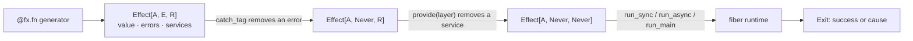

<p align="center">
  
</p>

<h1 align="center">pyfect</h1>

<p align="center">
  <a href="https://effect.website">Effect</a> for Python. Errors, dependencies and concurrency checked by pyright.
</p>

<p align="center">
  <a href="https://pyfect.dev/docs"></a>
  
  
  <a href="LICENSE"></a>
</p>

<p align="center">
  <a href="https://pyfect.dev/docs"><b>Read the docs</b></a> ·
  <a href="https://pyfect.dev/docs/installation">Install</a> ·
  <a href="examples/">Examples</a> ·
  <a href="docs/PARITY.md">Parity with Effect</a> ·
  <a href="CONTRIBUTING.md">Contribute</a>
</p>

---

pyfect lets you write Python programs whose type says what they return, how they can fail
and which services they need, so pyright rejects a program that forgets to handle an error
or provide a dependency. It is for Python developers building services, pipelines and CLIs
who want Effect's model (typed errors, structured concurrency, layers, streams, schema)
without leaving Python.

## A quick look

```python
from dataclasses import dataclass
from typing import Protocol

import pyfect as fx
from pyfect import layer


class UserStore(Protocol):
    def find(self, user_id: str) -> fx.Effect[str | None]: ...


class Users(fx.Tag[UserStore]): ...


class InMemoryUsers:
    def find(self, user_id: str) -> fx.Effect[str | None]:
        return fx.succeed({"1": "Ada"}.get(user_id))


@dataclass
class UserNotFound(fx.TaggedError):
    user_id: str


@fx.fn
def greet(user_id: str):
    users = yield from Users()
    name = yield from users.find(user_id)
    if name is None:
        return (yield from UserNotFound(user_id))
    return f"Hello, {name}!"


# greet("1") is inferred as Effect[str, UserNotFound, Users]

program = (
    greet("1")
    .pipe(fx.catch_tag(UserNotFound, lambda e: fx.succeed("Who?")))
    .pipe(fx.provide(layer.succeed(Users, InMemoryUsers())))
)

fx.run_sync(program)
```

Remove the `catch_tag` line and pyright stops you before the program runs:

```text
error: Argument of type "Effect[str, UserNotFound, Never]" cannot be assigned to
       parameter "eff" of type "Effect[A@run_sync, Never, Never]"
    Type "UserNotFound" is not assignable to type "Never"
```

[`examples/quickstart.py`](examples/quickstart.py) builds on this with a resource-managed
layer, concurrency, retries and timeouts.

## How it works



1. **Describe.** A generator decorated with `@fx.fn` builds an `Effect[A, E, R]`: a value
   that describes the work. Nothing runs yet, and pyright infers all three types with no
   annotations.
2. **Narrow.** Each handler removes exactly the error it handles, and each layer removes
   exactly the services it builds. The type shrinks as you go.
3. **Run.** Only an effect with no errors and no services left can run. pyfect runs it on
   its own fiber scheduler, synchronously or on asyncio, with structured concurrency and
   interruption that always runs finalizers.

## Features

- **Typed errors.** Expected failures live in the type; `catch_tag` handles one, and
  defects stay separate. [Errors →](https://pyfect.dev/docs/errors)
- **Services and layers.** Dependency injection checked by the type checker, with memoized,
  concurrently built layers that release their resources in order.
  [Services →](https://pyfect.dev/docs/services)
- **A fiber runtime of its own.** The same program runs with `run_sync` (no event loop) or on
  asyncio. `blocking` moves blocking calls to a thread. [Effects →](https://pyfect.dev/docs/effects)
- **Structured concurrency.** Children end with their parent; `all` and `for_each` take a
  concurrency limit; races wait for losers to clean up.
  [Concurrency →](https://pyfect.dev/docs/concurrency)
- **Resources.** Scopes, `acquire_release`, pools, `RcRef` and `RcMap` release exactly once,
  even on interruption. [Resources →](https://pyfect.dev/docs/resources)
- **Retries and schedules.** Exponential, jittered, cron and composed schedules for `retry`
  and `repeat`. [Schedules →](https://pyfect.dev/docs/schedules)
- **Streams.** Pull-based streams, sinks and channels with backpressure, plus NDJSON, JSON
  array and Server-Sent Events framers. [Streams →](https://pyfect.dev/docs/streams)
- **Schema.** Decode and encode data with Effect's error messages, generate JSON Schema and
  Hypothesis strategies, and plug into pydantic or msgspec.
  [Schema →](https://pyfect.dev/docs/schema)
- **Transactions.** Software transactional memory: `TxRef`, transactional queues, maps,
  locks and semaphores that commit atomically and retry without blocking a thread.
  [Transactions →](https://pyfect.dev/docs/transactions)
- **Config.** Typed settings from the environment, `.env` files or dicts, with secrets kept
  out of logs. [Config →](https://pyfect.dev/docs/config)
- **Observability.** Logging, spans, metrics and an OpenTelemetry bridge.
  [Observability →](https://pyfect.dev/docs/observability)
- **SQL.** Statements built from literal templates, so values are always bound parameters;
  transactions with savepoints, batching resolvers and migrations, on SQLite (standard
  library) or PostgreSQL (psycopg). [SQL →](https://pyfect.dev/docs/sql)
- **CLI.** Typed commands, flags and arguments with subcommands, generated help, shell
  completions and interactive prompts. [CLI →](https://pyfect.dev/docs/cli)
- **Deterministic tests.** A pytest plugin with a virtual clock, so a test of a 30-second
  retry takes no real time. [Testing →](https://pyfect.dev/docs/testing)

pyfect follows Effect v4 and runs Effect's own test cases as its spec: over 8,500 tests, and
about 77% of Effect's API so far, including the platform services (files, child processes, an
HTTP client, TCP, TLS, WebSocket and UDP sockets), SQL and the CLI library. [`docs/PARITY.md`](docs/PARITY.md) tracks what is done and
what is next.

## Installation

pyfect needs Python 3.13 or later and has no required dependencies.

```sh
uv add git+https://github.com/tylergibbs1/pyfect
```

Optional extras: `otel` (OpenTelemetry), `hypothesis`, `pydantic`, `msgspec`, `httpx` (the
HTTP client backend), `websockets` (WebSocket clients and servers) and `pg` (the PostgreSQL
driver, on psycopg), for example
`uv add "pyfect[otel] @ git+https://github.com/tylergibbs1/pyfect"`.

pyright is the type checker pyfect is designed for. In strict mode, add
`reportUnknownParameterType = false`: pyright reads an unannotated generator's send type as
`Unknown` ([pyright#10279](https://github.com/microsoft/pyright/issues/10279)), and effect
generators never use it. See [Installation](https://pyfect.dev/docs/installation).

## Learn more

- [Documentation](https://pyfect.dev/docs): guides for each part of the library.
- [API reference](https://pyfect.dev/docs/reference): every public function and class.
- [Examples](examples/): a quickstart, batching, a FastAPI-style service, a stream pipeline
  and schema decoding, all checked by pyright.
- [Effect's docs](https://effect.website/docs): the concepts carry over; pyfect uses
  snake_case and `yield from` in place of `yield*`.

## Contributing

Contributions are welcome. [`CONTRIBUTING.md`](CONTRIBUTING.md) covers setup, the one
command that checks everything, and how a change is ported from Effect. Issues labelled
[good first issue](https://github.com/tylergibbs1/pyfect/labels/good%20first%20issue) are a
good place to start. Everyone taking part agrees to the
[Code of Conduct](CODE_OF_CONDUCT.md).

## License

[MIT](LICENSE). pyfect is an independent port and is not affiliated with Effectful
Technologies; Effect is MIT-licensed by its authors.
